<div align="center">

# Langration

**옛 LangChain 코드를 최신 버전으로 고치고, 근거와 검사 결과까지 보여 주는 웹 서비스**

**팀원 소개**

| | 이름 | 역할 |
| --- | --- | --- |
|  | [최우석](https://github.com/wsc9150) | Django 프로젝트 구조 설계 / API 엔드포인트 정의 · 백엔드 구현 / TiDB 모델 · 비밀번호 로그인 / 발표 |
|  | [조현주](https://github.com/zozuzu) | AWS EC2 · Docker Compose 배포 환경 구축 / 분류기 보완(no_code · route_error) / LLM 파이프라인 검증 |
|  | [손채영](https://github.com/cchhaaee1023) | RAGAS 평가 도입 · 코드 변환 평가 재실행 / 분류기 개선안 도출 / 파이프라인 QA |
|  | [심성욱](https://github.com/SKN35shimsungwook) | 화면 UI 구현 · 진행 단계 스트리밍 표시 / 백엔드 API 연결 보조 / 발표자료 · README · 산출물 제작 |

**기술 스택**


<br/>


[**배포 화면**](http://16.176.158.134/) · [3차 → 4차](#2-문제와-3차--4차-변경-사항) · [구성도](#4-시스템-구성도) · [LLM](#5-llm-아키텍처) · [실행](#9-실행-방법) · [평가](#10-평가) · [화면](#13-실제-화면) · [문서](#14-문서) · [회고](#15-한-줄-회고) · [3차 저장소](https://github.com/SKNETWORKS-FAMILY-AICAMP/SKN35-3rd-4Team)

</div>

<p align="center">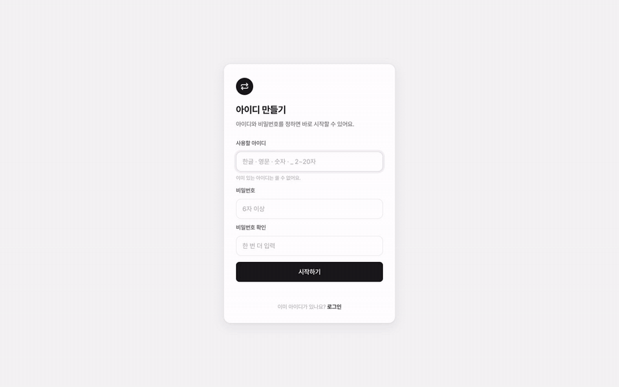</p>
<p align="center"><sub>실제 배포 화면 (2026-11-05, 2배속) · 로그인 → 코드 변환 예제 → 진행 단계 실시간 표시 → 결과 패널 탭 → 문서 질문 · <a href="docs/images/demo.mp4">원본 동영상</a></sub></p>

> 3차에서 만든 **근거 기반 LangChain 마이그레이션 챗봇**을, 4차에서 **Django 웹 서비스**로 다시 지어 **AWS EC2에 Docker로 배포**했습니다.
> 평가는 코드 변환에 더해 **문서 질의응답(RAG)까지 RAGAS로** 넓혔습니다.

| | |
|---|---|
| 과제 주제 | LLM을 연동한 내외부 문서 기반 질의응답 시스템 (웹 서비스 · 배포) |
| 팀 | SKN35 4th 4Team |
| 발표 | 2026-11-05 |
| 배포 주소 | http://16.176.158.134/ |
| 3차 저장소 | [SKNETWORKS-FAMILY-AICAMP/SKN35-3rd-4Team](https://github.com/SKNETWORKS-FAMILY-AICAMP/SKN35-3rd-4Team) |

**목차**

1. [진행 상황](#1-진행-상황)
2. [문제와 3차 → 4차 변경 사항](#2-문제와-3차--4차-변경-사항)
3. [주요 기능](#3-주요-기능)
4. [시스템 구성도](#4-시스템-구성도)
5. [LLM 아키텍처](#5-llm-아키텍처)
6. [RAG 데이터](#6-rag-데이터)
7. [기술 스택](#7-기술-스택)
8. [폴더 구조](#8-폴더-구조)
9. [실행 방법](#9-실행-방법)
10. [평가](#10-평가)
11. [만들면서 발견한 것](#11-만들면서-발견한-것)
12. [한계와 다음 단계](#12-한계와-다음-단계)
13. [실제 화면](#13-실제-화면)
14. [문서](#14-문서)
15. [한 줄 회고](#15-한-줄-회고)
16. [참고 자료](#16-참고-자료)

---

## 1. 진행 상황

2026-11-05 발표 당일 기준

| 구분 | 내용 | 상태 |
|---|---|---|
| 백엔드 | Django 프로젝트 · `users` · `langration` 앱, 3차 파이프라인 이관, API 8개, 채팅 스트리밍, TiDB 모델 · 비밀번호 해시 로그인 | ✅ 완료 |
| 배포 | Dockerfile · Docker Compose(Django + Gunicorn · Nginx) · `deploy.sh`, AWS EC2 배포 | ✅ http://16.176.158.134/ |
| 분류기 보완 | 코드 규칙(R1 · R2) 먼저, 코드 없으면 안내(`no_code`), 분류 실패 기록(`route_error`), 일반 답변 temperature 0.3 | ✅ 완료 |
| 화면 | 로그인 · 가입 · 대화 화면, 진행 단계 실시간 표시, 결과 패널, 새 대화 · 대화 삭제, 확인용 예제 60개(서랍 두 개) | ✅ 완료 |
| 평가 | 코드 변환 평가 다시 측정(3차 대비), RAGAS 문서 질의응답 30문항, 검증 결과 정리 | ✅ 완료 |
| 발표 | 발표자료 15장 · 대본 · 예상 질문 | ✅ 2026-11-05 |

## 2. 문제와 3차 → 4차 변경 사항

**문제: 버전 지체 환각**

LangChain은 1.0에서 패키지가 나뉘고 옛 체인 · 에이전트(`LLMChain`, `initialize_agent` 등)가 빠졌습니다. 그런데 LLM은 학습한 옛 버전 코드를 그대로 답하고, 틀렸다는 것도 모릅니다. 3차 실험에서 일반 LLM(gpt-4o-mini)은 **30개 중 29개에서 옛 import를 그대로 두고 "수정했다"고 답했습니다.** Langration은 근거(import 대응표 · 공식 문서)로 고치고, LLM 없이 코드로 검사해 이 문제를 줄입니다. 자세한 배경은 [3차 저장소](https://github.com/SKNETWORKS-FAMILY-AICAMP/SKN35-3rd-4Team)에 있습니다.

**3차의 보완점**

| 구분 | 3차의 한계 | 4차 해결 방향 |
|---|---|---|
| 배포 | Streamlit Cloud 앱 하나에 화면 · 그래프 · 저장이 모두 실려 역할을 나누거나 옮기기 어려움 | Django API 서버와 화면을 나누고 Docker로 묶어 AWS EC2에 배포 |
| 사용자 | 비밀번호 없이 아이디만으로 로그인, 대화 삭제 없음 | 비밀번호 해시 로그인, 대화 삭제 |
| 평가 | 코드 변환만 평가, 문서 질문 답변은 재지 않음 · 최종 검증 통과 53% | 코드 변환 다시 측정 + RAGAS 문서 질의응답 평가 |

**바뀐 점 · 수정된 점 · 업그레이드된 점**

| 항목 | 3차 | 4차 | 구분 |
|---|---|---|---|
| 화면 | Streamlit | Django 템플릿 + HTML · CSS · JS | 바뀐 점 |
| 백엔드 | 화면에서 그래프 직접 호출 | Django API (`users` · `langration` 앱) | 바뀐 점 |
| 배포 | Streamlit Cloud | Docker Compose (Django + Gunicorn · Nginx) → AWS EC2 | 바뀐 점 |
| 진행 표시 | Streamlit이 화면을 다시 그림 | 서버가 단계마다 한 줄씩 전송 (NDJSON 스트리밍), Nginx 버퍼링 끔 | 바뀐 점 |
| 로그인 | 아이디만 | 아이디 + 비밀번호 (PBKDF2 해시 저장) | 업그레이드 |
| 대화 관리 | 목록 · 다시 열기 | 목록 · 다시 열기 · 삭제 | 업그레이드 |
| 질문 분류 | LLM이 판단 | 코드 규칙 먼저(R1 · R2) + LLM, 코드 없으면 안내(`no_code`), 분류 실패 기록(`route_error`) | 수정된 점 |
| 일반 답변 | temperature 0.7 | temperature 0.3 | 수정된 점 |
| 평가 | 코드 변환 평가 | 코드 변환 평가 다시 측정 + 문서 질의응답 RAGAS 평가 | 업그레이드 |
| 확인용 예제 | 코드 변환 30개 | 코드 변환 평가 문항 30개 + RAG 평가 문항 30개 (서랍 두 개) | 업그레이드 |

그대로인 것: gpt-4o-mini · LangGraph 변환 파이프라인(analyzer → retriever → rewriter → verifier) · RAG 데이터 · verifier 11가지 검사

## 3. 주요 기능

**3차부터 이어 온 기능**

| 기능 | 내용 |
|---|---|
| 코드 마이그레이션 | 0.x 코드를 1.x로, 버전을 적으면 옛 버전으로 되돌리기도 |
| 근거 기반 변경 | 바뀐 줄마다 근거 ID와 이유 |
| 자동 검사 + 재시도 | verifier 11가지 검사, 실패하면 이유를 들고 최대 3회 다시 |
| 설치 패키지 안내 | 새 코드가 쓰는 패키지 목록 |
| 문서 검색 Q&A | 버전 변화 질문은 공식 문서에서 찾아 답변 |

**4차 웹 기능**

| 기능 | 내용 |
|---|---|
| 회원가입 · 로그인 | 아이디(한글 · 영문 · 숫자 · `_` 2~20자) + 비밀번호(6~64자), 해시로만 저장 |
| 대화 관리 | 새 대화 · 내 대화 목록 · 다시 열기 · 삭제 |
| 실시간 진행 표시 | 그래프 단계가 끝날 때마다 진행 상자에 한 줄씩, 맨 아래에 지금 단계 |
| 결과 패널 | 전후 비교 · 변경 사항 · 근거 · 검사 결과 · 코드 받기 |
| 확인용 예제 | 코드 변환 평가 문항 30개 · RAG 평가 문항 30개, 누르면 바로 전송 |
| 어디서나 접속 | AWS EC2 배포 주소 하나로 |

## 4. 시스템 구성도

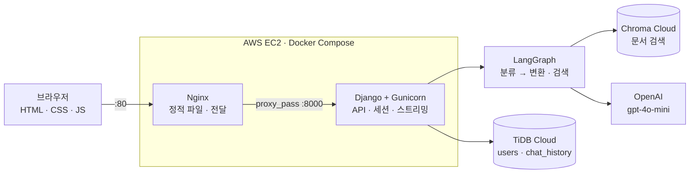

**요청 흐름 (채팅)**

1. 화면이 `POST /api/langration/chat/`로 질문을 보냅니다.
2. Django가 별도 스레드에서 LangGraph를 돌리고, 단계가 끝날 때마다 큐에 넣은 진행 상황을 NDJSON 한 줄(`step`)로 바로 보냅니다.
3. Nginx는 버퍼링을 끈 채 그대로 전달하고, 화면은 도착한 줄을 진행 상자에 쌓습니다.
4. 마지막 줄(`done`)에 답과 결과 패널 데이터가 오면, 질문과 답을 TiDB `chat_history`에 저장합니다.

**설정을 이렇게 한 이유**

| 설정 | 이유 |
|---|---|
| Nginx까지 Docker Compose로 묶음 | 서버에서 `bash deploy/deploy.sh` 명령 하나로 받기 · 빌드 · 실행 |
| 외부에는 80번만 열고 Django는 내부 8000번 | Gunicorn을 바로 노출하지 않고 Nginx 뒤에 둠 |
| 정적 파일은 Nginx가 직접 전달 | Django가 CSS · JS까지 처리하지 않도록 공유 볼륨으로 넘김 |
| 스트리밍 응답 버퍼링 끔 (`proxy_buffering off`, `X-Accel-Buffering: no`) | Nginx가 응답을 모았다가 한 번에 보내면 진행 단계가 실시간으로 안 보임 |
| Gunicorn worker 1개 · thread 4개 · timeout 180초 | 그래프의 대화 기억이 서버 메모리에 있어 한 프로세스에 유지, 긴 답변도 끊기지 않게 |
| 15초마다 빈 줄(keepalive) | 답이 오래 걸릴 때 연결이 끊기지 않게 |

### 4-1. API 명세

| 앱 | 메서드 | 경로 | 하는 일 |
|---|---|---|---|
| `users` | POST | `/api/users/signup/` | 회원가입 (아이디 중복 검사 · 비밀번호 해시 저장) |
| `users` | POST | `/api/users/login/` | 로그인 (세션 발급) |
| `users` | POST | `/api/users/logout/` | 로그아웃 |
| `langration` | POST | `/api/langration/sessions/` | 새 대화 만들기 |
| `langration` | GET | `/api/langration/sessions/` | 내 대화 목록 |
| `langration` | GET | `/api/langration/sessions/<id>/` | 대화 불러오기 (질문 · 답 기록) |
| `langration` | DELETE | `/api/langration/sessions/<id>/` | 대화 삭제 |
| `langration` | POST | `/api/langration/chat/` | LLM 질문 (NDJSON 스트리밍) |

채팅 스트리밍은 한 줄에 JSON 하나씩 보냅니다: `step`(진행 단계) 여러 줄 → `done`(답 · 결과 패널 데이터) 한 줄. 실패하면 `error` 한 줄.

### 4-2. DB 설계 (TiDB)

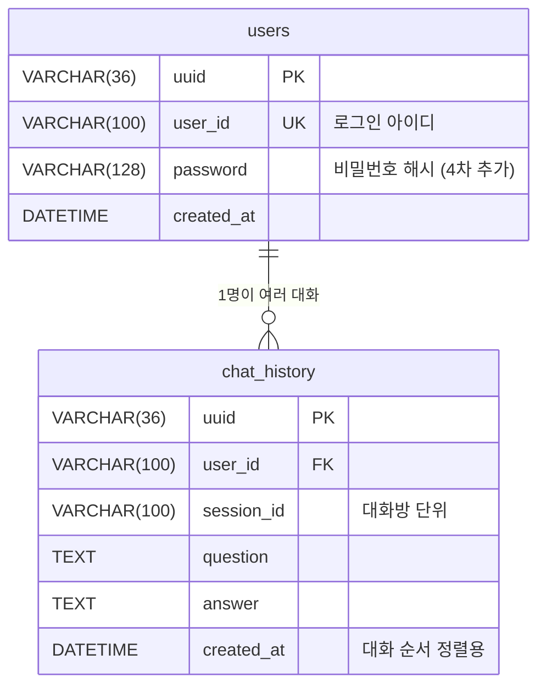

- 질문 하나와 그 답이 `chat_history` 한 행이고, 대화 목록은 `session_id`로 묶어서 보여 줍니다.
- 비밀번호는 원문 없이 Django 해시(PBKDF2-SHA256)로만 저장합니다.

## 5. LLM 아키텍처

**최상위 그래프와 마이그레이션 서브그래프**

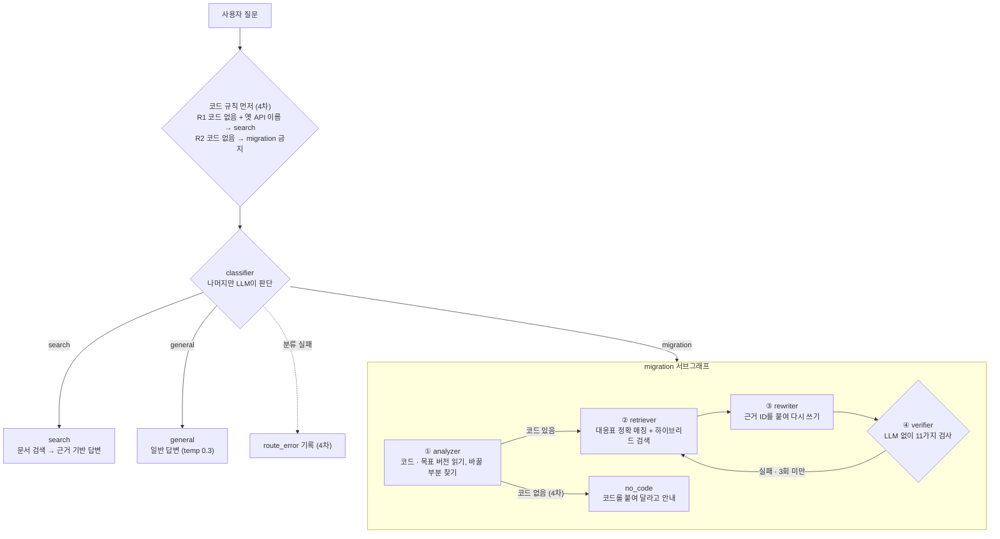

**노드 역할**

| 순서 | 노드 | LLM | 하는 일 | 4차 변경 |
|---|---|---|---|---|
| 0 | classifier | gpt-4o-mini | migration · search · general 중 하나로 분류 | 코드 규칙(R1 · R2)을 먼저 적용, 분류 실패를 `route_error`로 기록 |
| ① | analyzer | gpt-4o-mini | 코드 원문 · 목표 버전(없으면 최신) · 바꿀 부분을 JSON으로 | 코드가 없으면 `no_code`로 보냄 |
| ② | retriever | 없음 | 대응표 정확 매칭 → 메서드 매칭 → 문서 하이브리드 검색(BM25 + 벡터, RRF), 재시도 때 틀린 근거 제외 | 대화 사이 제외 목록 초기화 |
| ③ | rewriter | gpt-4o-mini | 근거에 있는 것만 써서 다시 쓰기, 바뀐 줄마다 근거 ID | - |
| ④ | verifier | 없음 | 11가지 검사, 실패하면 이유를 다음 시도에 넘김 (최대 3회) | - |
| - | no_code | 없음 | 고칠 코드가 없을 때 변환하지 않고 안내 | 4차 추가 |
| - | search · general | gpt-4o-mini | 문서 근거로 답 + 출처 / 일반 답 | general temperature 0.7 → 0.3 |

**verifier 11가지 검사**: ① 문법 ② 근거 ID ③ 변경 기록 ④ 남은 옛 import ⑤ import 존재 ⑥ 남은 옛 메서드(경고) ⑦ 안 쓰는 import ⑧ 반환값 보존 ⑨ 정의 안 된 이름 ⑩ 출력 꺼내기 ⑪ 체인 입출력 키

## 6. RAG 데이터

3차에서 구축한 데이터를 그대로 사용합니다.

| 데이터 | 규모 | 내용 |
|---|---|---|
| import 대응표 | 9,155건 | 옛 import 경로 → 1.x 경로 (PyPI 패키지 코드 분석 + langchain-cli 규칙 병합) |
| 메서드 대응표 | 42건 | `.run` → `.invoke` 등 |
| 최신 공식 문서 | 271페이지 | docs.langchain.com |
| 마이그레이션 가이드 | 24페이지 | 0.3.30 공식 가이드 |
| 청크 | 11,903개 | Chroma Cloud · text-embedding-3-small (1536차원) |

**검색 흐름**

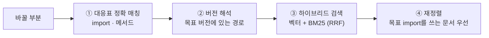

## 7. 기술 스택

| 영역 | 기술 |
|---|---|
| 화면 | Django 템플릿 · HTML · CSS · JavaScript · marked · DOMPurify |
| 백엔드 | Django 5.2 · Gunicorn · 세션 로그인 · StreamingHttpResponse(NDJSON) |
| AI | LangGraph · LangChain 1.x · OpenAI gpt-4o-mini |
| 검색 | Chroma Cloud · BM25 + RRF · text-embedding-3-small |
| 데이터베이스 | TiDB Cloud · django-tidb |
| 배포 | Docker · Docker Compose · Nginx · AWS EC2 |
| 평가 | RAGAS · 자체 채점 스크립트(LLM 없이) |
| 패키지 관리 | uv |

## 8. 폴더 구조

> [정리 예정] `작업기록/` 폴더는 삭제하고 `docs/` 폴더로 통일한 뒤, 폴더 이름을 `산출물/`로 바꿀 예정입니다.

| 영역 | 경로 | 내용 |
|---|---|---|
| 설정 | `config/` | Django 설정(`settings.py` · TiDB 연결 · 정적 파일) · 최상위 URL |
| 사용자 앱 | `users/` | 회원가입 · 로그인 · 로그아웃 페이지와 API, `users` 모델 |
| 변환 앱 | `langration/` | 대화 화면 · 대화 세션 · 채팅 스트리밍 API, `chat_history` 모델 |
| 그래프 | `langration/src/graph/` | 최상위 그래프(`supervisor.py`) · 변환 서브그래프(`migration.py`) · 노드(`nodes/`) |
| 프롬프트 | `langration/src/prompt/` | classifier · analyzer · rewriter · search · general 프롬프트 |
| RAG | `langration/src/rag/` | 문서 수집 · import 대응표 · 청킹 · 임베딩 · 검색 |
| 그래프 연결 | `langration/src/ui/` | 그래프 호출(`client.py`) · 결과 정리 |
| 화면 | `templates/` · `static/` | HTML 템플릿, CSS · JS, 확인용 예제(`static/data/examples.json`) |
| 데이터 | `data/` | RAG 원본 · 가공 데이터 |
| 평가 | `eval/` | 코드 변환 평가 · RAGAS 평가 스크립트, 문항, 결과 |
| 배포 | `Dockerfile` · `docker-compose.yml` · `deploy/` | 컨테이너 설정 · Nginx 설정 · 배포 스크립트 |
| 문서 | `docs/` | 검증 결과 정리 · 분류기 개선안 등 산출물 |

## 9. 실행 방법

**환경 변수 (`.env`)**

| 키 | 용도 |
|---|---|
| `OPENAI_API_KEY` | gpt-4o-mini · 임베딩 |
| `CHROMA_API_KEY` · `CHROMA_TENANT` · `CHROMA_DATABASE` | Chroma Cloud 문서 검색 |
| `TIDB_HOST` · `TIDB_PORT` · `TIDB_USER` · `TIDB_PASSWORD` · `TIDB_DATABASE` | TiDB Cloud 연결 |
| `TIDB_CA_PATH` | TiDB 인증서 경로 (없으면 기본 인증서 사용) |
| `DJANGO_SECRET_KEY` · `DJANGO_DEBUG` | Django 비밀 키 · 디버그 모드 (배포는 False) |
| `DJANGO_ALLOWED_HOSTS` · `DJANGO_CSRF_TRUSTED_ORIGINS` | 접속 허용 주소 |

**로컬 실행**

```bash
uv sync
uv run python manage.py migrate
uv run python manage.py runserver
```

브라우저에서 `http://127.0.0.1:8000/`을 열고 회원가입 후 사용합니다.

**서버 배포 (AWS EC2)**

```bash
# EC2에서 처음 한 번: 저장소를 받고 .env를 만든 뒤, 보안 그룹 80번 포트 열기
git clone https://github.com/SKNETWORKS-FAMILY-AICAMP/SKN35-4th-4Team.git
cd SKN35-4th-4Team

# 배포 (dev 최신 코드 받기 → web · nginx 빌드 · 실행 → 상태 · 로그 확인)
bash deploy/deploy.sh
```

컨테이너가 시작되면 `migrate` → `collectstatic` → `gunicorn` 순서로 실행됩니다. 새로 배포한 뒤에는 브라우저에서 **Ctrl+F5**로 새로고침해야 바뀐 CSS · JS가 보입니다.

## 10. 평가

평가 스크립트와 자세한 결과는 [eval/README.md](eval/README.md)에 있습니다.

### 10-1. 문서 질의응답 평가 (RAGAS)

- 문항: 문서 질의응답 30개 (문서에 답 있음 26 · 없음 4), [`eval/ragas_questions_gpt2.json`](eval/ragas_questions_gpt2.json)
- 답 생성 gpt-4o-mini · 채점 gpt-4o · 실제 화면처럼 분류부터 거친 최종 답(e2e) 기준 · 2026-11-05 측정

| 지표 | Langration | 일반 LLM (문서 없이) |
|---|---:|---:|
| 근거 충실도 `faithfulness` | **0.89** | - |
| 정답과 사실 일치 `factual_correctness` | **0.48** | 0.32 |
| 질문에 맞는 답 `answer_relevancy` | 0.50 | 0.54 |
| 찾은 문서 정밀도 `context_precision` | 0.60 | - |
| 찾은 문서 재현율 `context_recall` | 0.69 | - |

결과: [`eval/results/RAGAS_gpt2-questions/`](eval/results/RAGAS_gpt2-questions/)

평가 과정에서 search로 가야 할 질문 상당수가 classifier에서 general로 빠지는 것을 발견했고, 이를 바탕으로 분류기를 보완했습니다 (코드 규칙 · `no_code` · `route_error`, [docs/분류기_개선안.md](docs/분류기_개선안.md)).

### 10-2. 코드 변환 평가 (3차 대비)

같은 30문항(1.x로 올리기) · 같은 채점 스크립트 · gpt-4o-mini, 3차 2026-10-15 / 4차 2026-11-04 측정

| 지표 | 설명 | 3차 | 4차 |
|---|---|---:|---:|
| 공통 기준 통과 | 실행 기준 + 정답 import까지 모두 맞음 | 57% | **63%** |
| 실행 기준 통과 | 문법 · 옛 import 없음 · import 존재 · 결과값 보존 | 87% | **93%** |
| 최종 검증 통과 | 최대 3회 재시도 안에 검사 통과 | 53% | **93%** |
| 1회차 검증 통과 | 재시도 없이 첫 시도에 통과 | 43% | **60%** |
| 자체 평가 | 팀 규칙 21항목 | 83.3점 (B) | **91.8점 (A)** |

같은 문항을 일반 LLM에 주면 공통 기준 · 실행 기준 모두 0%입니다.

## 11. 만들면서 발견한 것

- **스트리밍은 서버만 보낸다고 끝나지 않습니다.** Django가 단계마다 보내도 Nginx가 응답을 모았다가 한 번에 넘겨, 진행 단계가 끝에 몰려서 나왔습니다. 응답 헤더(`X-Accel-Buffering: no`)와 Nginx 설정(`proxy_buffering off`)으로 버퍼링을 꺼서 해결했습니다.
- **재배포해도 화면이 안 바뀌는 건 대부분 브라우저 캐시였습니다.** 서버에는 새 CSS · JS가 올라가 있었지만 브라우저가 예전 파일을 계속 썼습니다. 배포 후 Ctrl+F5(강력 새로고침)로 해결합니다.
- **답을 잘 만드는 것만큼 질문을 맞는 길로 보내는 게 중요했습니다.** RAGAS 평가에서 search로 가야 할 질문 상당수가 general로 빠지는 것을 찾았고, 코드 유무 · 옛 API 이름처럼 확실한 신호는 LLM 전에 코드 규칙으로 먼저 판정하도록 바꿨습니다.
- **로그인 응답 시간으로도 정보가 샙니다.** 없는 아이디는 바로, 틀린 비밀번호는 해시 비교 때문에 늦게 응답해서 아이디 존재 여부가 드러났습니다. 없는 아이디도 같은 시간이 걸리게 맞추고, 오류 문구도 똑같이 했습니다.
- **코드 없는 질문은 코드 없는 길로 보내야 합니다.** 문서 질문 예제에 빈 코드 블록이 붙어 가면 분류기가 코드 변환 요청으로 오해할 수 있어, 코드가 없는 예제는 질문만 보내게 했습니다.

## 12. 한계와 다음 단계

| 한계 | 다음 단계 |
|---|---|
| HTTP로만 열려 있음 (HTTPS 없음) | 도메인 연결 후 인증서를 붙여 HTTPS로 |
| 그래프의 대화 기억이 서버 메모리에 있어 서버를 다시 켜면 사라지고, worker를 늘릴 수 없음 (TiDB 기록은 남음) | 대화 기억을 DB · Redis 체크포인터로 옮긴 뒤 worker · 서버 확장 |
| 버전 오가기(옛 버전으로 되돌리기) 6문항은 정답 import 17%로 약함 (11-04 측정) | 목표 버전별 도구 목록으로 검사하도록 verifier 보강 |
| 코드 변환 요청을 migration으로 분류하는 비율 84% (32/38, 11-04 분류기 보완 전 측정) | 분류 규칙 · 프롬프트 추가 보완, 평가 문항 확대 |
| 근거 검색 · 검사 · 재시도로 응답이 일반 LLM보다 느림 (중앙값 11.5초 vs 3.4초) | 진행 단계 실시간 표시로 체감 대기 줄임 (적용), 캐시 · 병렬 검색 검토 |
| 코드는 정적으로만 검사 (실제 실행 결과는 미확인) | 실행 테스트 추가 |

## 13. 실제 화면

배포 화면(http://16.176.158.134/)에서 찍은 사진입니다 (2026-11-05).

**로그인 · 가입**

| 로그인 | 아이디 만들기 |
|:---:|:---:|
| 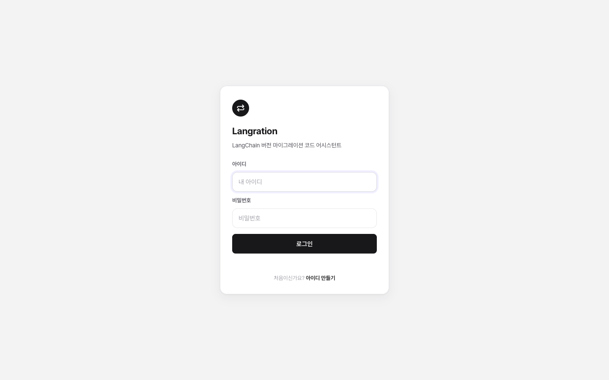 | 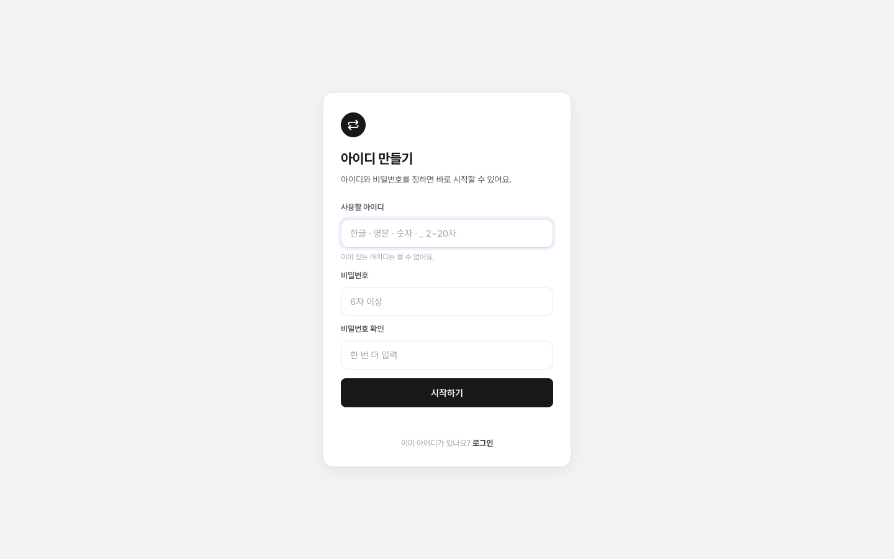 |

**첫 화면 · 사용법 · 확인용 예제**

| 첫 화면 (추천 질문) | 쓰는 방법 |
|:---:|:---:|
| 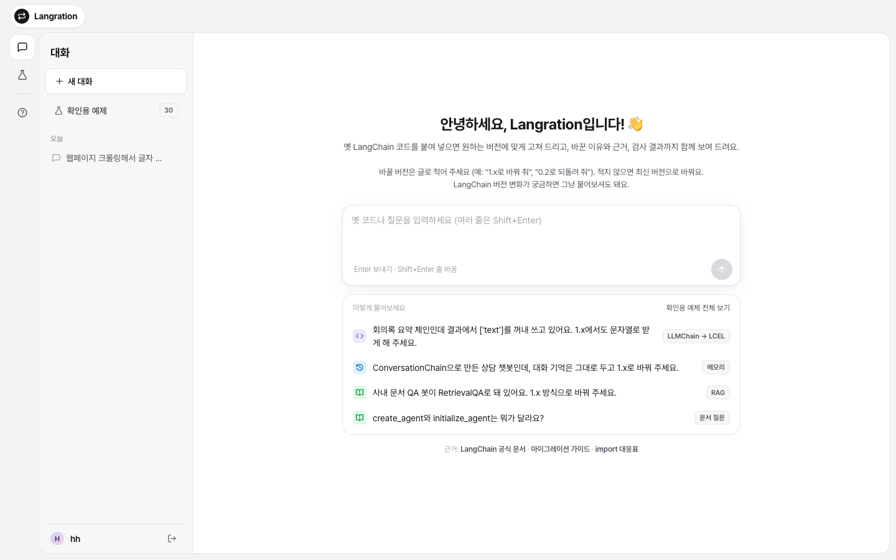 | 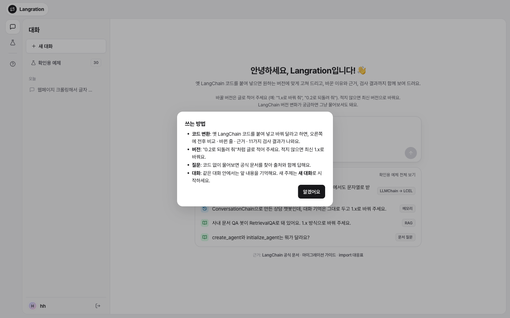 |
| **확인용 예제 (서랍 두 개)** | **RAG 평가 문항 서랍** |
| 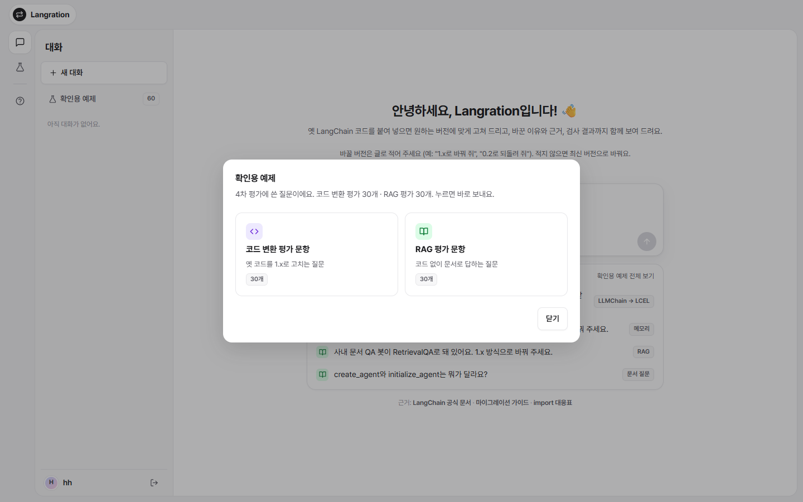 | 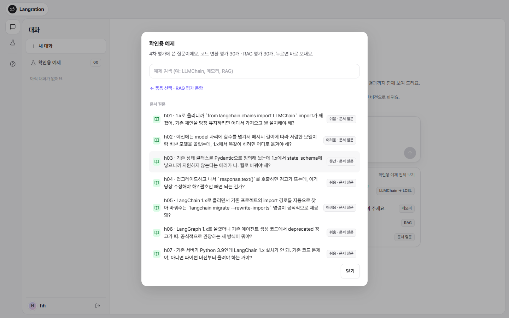 |

**코드 변환: 진행 단계 → 결과 패널**

| 진행 단계 실시간 표시 | 전후 비교 |
|:---:|:---:|
| 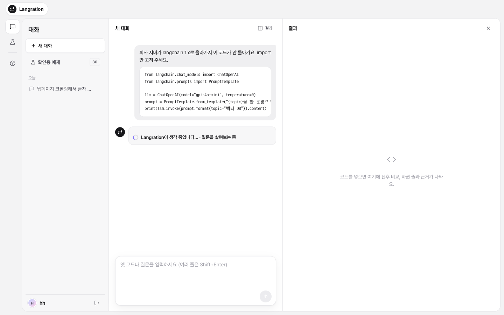 | 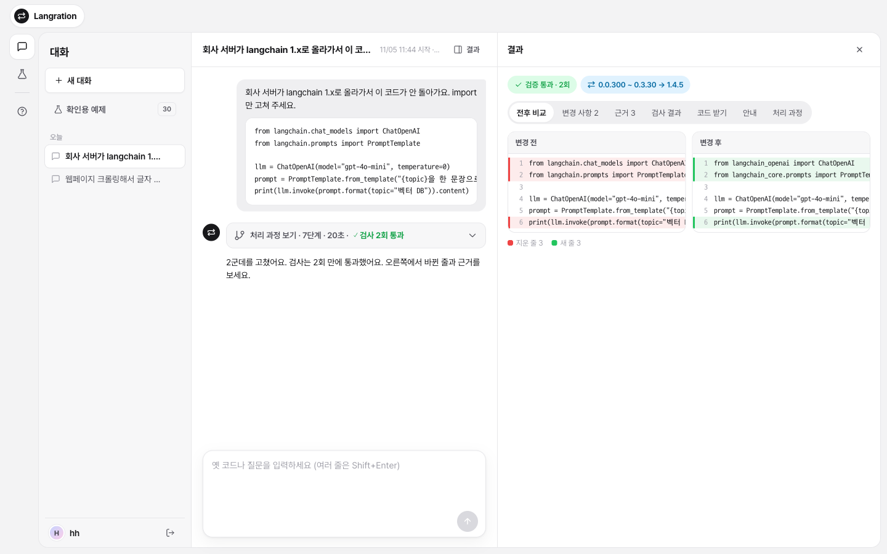 |
| **변경 사항** | **근거** |
| 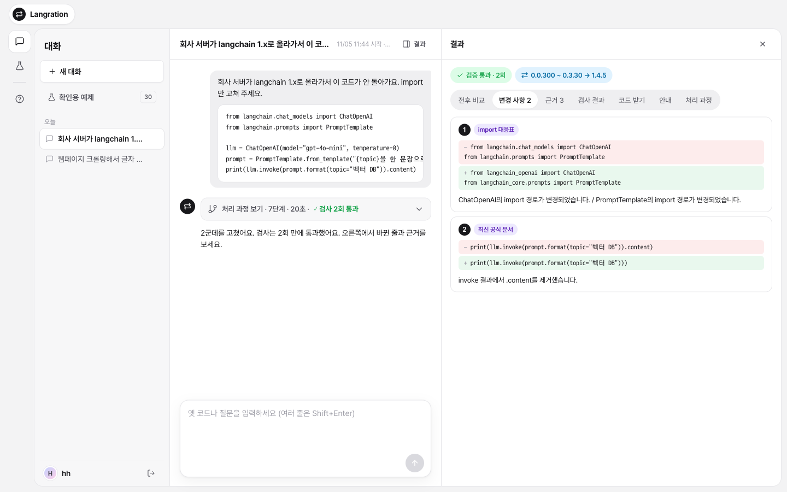 | 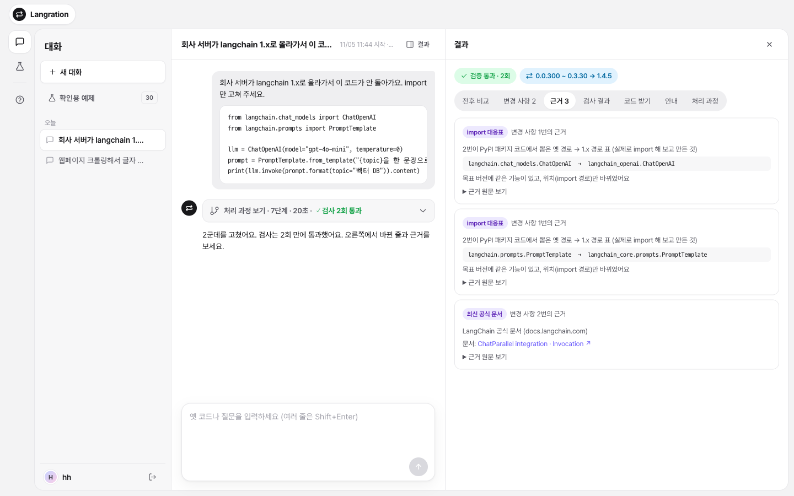 |
| **검사 결과 (11가지)** | **안내 (설치할 패키지)** |
| 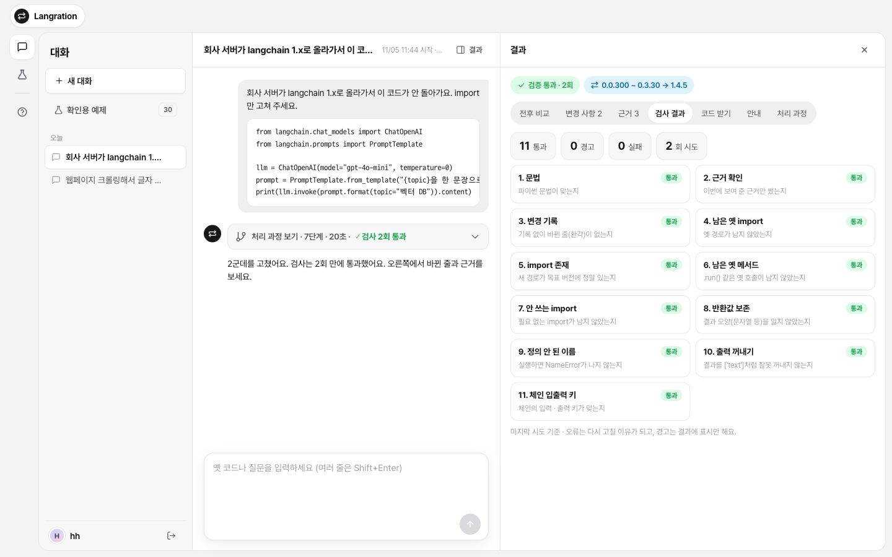 | 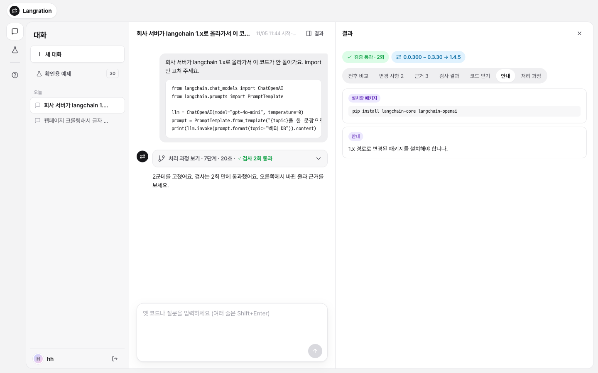 |
| **처리 과정 (1회차 실패 → 2회차 통과)** | **결과 패널 닫기** |
| 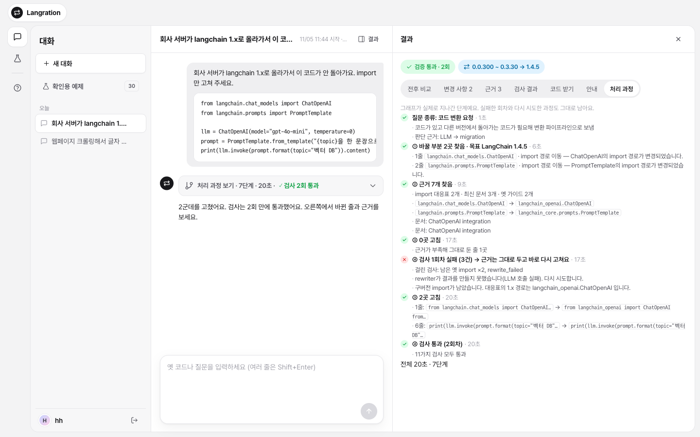 | 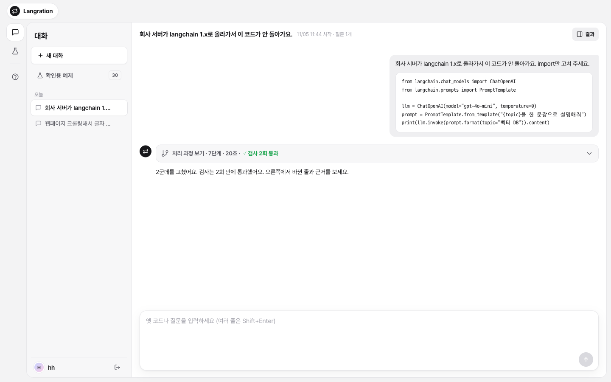 |

**문서 질문 · 대화 관리**

| 문서 질문 답변 (출처 표시) | 로그아웃 확인 |
|:---:|:---:|
| 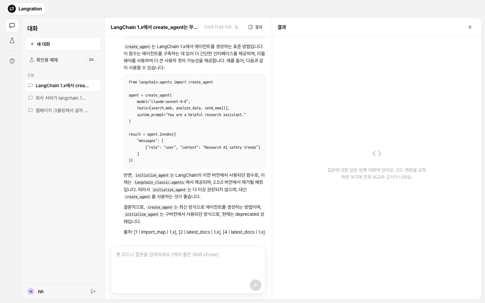 | 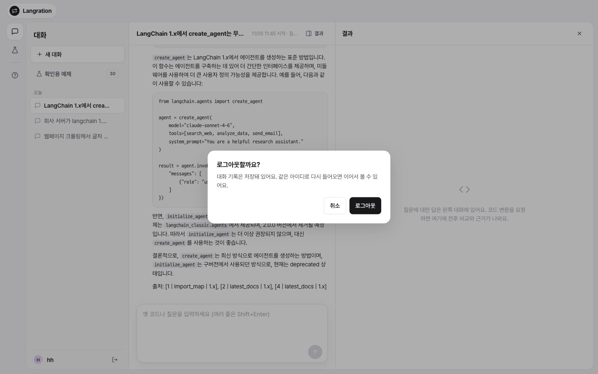 |

## 14. 문서

| 문서 | 내용 | 작성자 |
|---|---|---|
| [eval/README.md](eval/README.md) | 코드 변환 평가 · RAGAS 평가 방법, 문항, 결과 | 손채영 |
| [docs/검증_결과_정리.pdf](docs/검증_결과_정리.pdf) · [HTML](docs/검증_결과_정리.html) | 4차 검증 결과 보고서 | 손채영 |
| [docs/분류기_개선안.md](docs/분류기_개선안.md) | search → general 오분류 발견과 분류기 보완안 | 손채영 |
| [docs/API_명세.md](docs/API_명세.md) | API 엔드포인트별 요청 · 응답 · 오류, 채팅 스트리밍 이벤트 형식 | 심성욱 |
| [docs/배포_가이드.md](docs/배포_가이드.md) | EC2 준비 · 환경 변수 · `deploy.sh` · Nginx 설정 · 재배포 · 자주 나는 문제 | 심성욱 |
| [docs/DB_설계.md](docs/DB_설계.md) | ERD, 비밀번호 칸 추가, 대화 세션 저장 방식 | 심성욱 |
| [docs/main_배포_전환_가이드.md](docs/main_배포_전환_가이드.md) | `dev` 기준 배포를 `main` 기준으로 바꾸는 순서 · 확인 · 되돌리기 | 심성욱 |
| [발표자료 PDF](docs/발표자료/Langration_4차_발표.pdf) · [발표 대본](docs/발표자료/4차_발표_대본.pdf) · [예상 질문](docs/발표자료/4차_예상질문.pdf) | 발표 15장 · 15분 대본 · 예상 질문 21개와 답변 | 심성욱 |

## 15. 한 줄 회고

| 이름 | 회고 |
|---|---|
| 최우석 | 배우고 싶었던 기술들을 직접 사용해볼 수 있는 좋은 경험이었던 것 같고, 전체적인 프로젝트 구조 설계를 맡아 진행하면서 기술이나 구조에 대한 이해도를 많이 높일 수 있었습니다. 좋은 팀원분들 덕분에 3, 4차 프로젝트를 재밌게 할 수 있어서 감사 인사를 드립니다. |
| 조현주 | EC2 서버 구축부터 Docker Compose 배포까지 직접 해본 프로젝트였습니다. 평가 결과에서 챗봇의 품질을 깎았던 부분들을 다시 redefine하여 3차의 약점을 보완했습니다. 3차에 이어 4차까지 좋은 팀원분들과 함께할 수 있어서 감사했습니다. |
| 손채영 | 이번 프로젝트에 RAGAS를 사용해서 검증, 평가를 해보았습니다. search 경로로 가야 할 질문 상당수가 classifier에서 general로 빠지고 있었다는 걸 알게 되었고, 답을 잘 만드는 것만큼 적절한 라우팅이 중요하다는 걸 배웠습니다. |
| 심성욱 | 화면을 맡아 팀 채팅으로 들어온 수정 요청을 직접 고치고, 배포 화면에서 오류를 다시 확인하는 일을 반복했습니다. 진행 단계가 몰려서 나오거나 지운 대화가 목록에 남는 것처럼 겉으로는 화면 문제였지만 원인은 서버 설정이나 브라우저 캐시에 있는 경우가 많아, 증상에서 끝내지 않고 원인까지 따라가 확인하는 습관이 생겼습니다. 3차에 이어 4차까지 함께한 팀원분들께 감사합니다. |

## 16. 참고 자료

- [LangChain v1 마이그레이션 가이드](https://docs.langchain.com/oss/python/migrate/langchain-v1)
- [LangGraph 문서](https://docs.langchain.com/oss/python/langgraph/overview)
- [RAGAS 문서](https://docs.ragas.io/)
- [Django 문서](https://docs.djangoproject.com/)
- [Docker Compose 문서](https://docs.docker.com/compose/)
- 3차 프로젝트: [SKNETWORKS-FAMILY-AICAMP/SKN35-3rd-4Team](https://github.com/SKNETWORKS-FAMILY-AICAMP/SKN35-3rd-4Team)
