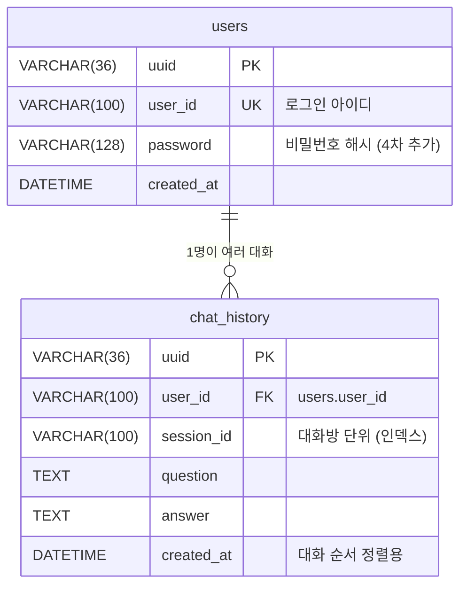

# DB 설계

Langration 4차 데이터베이스(TiDB Cloud) 정리입니다. Django 모델 · 마이그레이션으로 관리합니다.

- 기준: 2026-11-05 `dev`
- 연결: `django-tidb` (`config/settings.py`, `TIDB_*` 환경 변수, SSL 인증서)

## 1. ERD

## 2. 테이블

### `users` (`users.models.User`)

| 칸 | 형식 | 설명 |
|---|---|---|
| `uuid` | VARCHAR(36) PK | 자동 생성 (`utils/generate_uuid.py`) |
| `user_id` | VARCHAR(100) UNIQUE | 로그인 아이디 (한글 · 영문 · 숫자 · `_` 2~20자) |
| `password` | VARCHAR(128) | 비밀번호 해시. 원문은 저장하지 않음. 기본값 `''` |
| `created_at` | DATETIME | 가입 시각 |

### `chat_history` (`langration.models.ChatHistory`)

| 칸 | 형식 | 설명 |
|---|---|---|
| `uuid` | VARCHAR(36) PK | 자동 생성 |
| `user_id` | VARCHAR(100) FK → `users.user_id` | 사용자가 지워지면 기록도 지움 (CASCADE) |
| `session_id` | VARCHAR(100), 인덱스 | 대화방 단위. 새 대화 = 새 번호 |
| `question` | TEXT | 질문 원문 (코드 포함) |
| `answer` | TEXT | 대화에 보인 답 (코드 변환이면 요약 문장) |
| `created_at` | DATETIME | 저장 시각 (정렬 기준) |

## 3. 마이그레이션

| 파일 | 내용 |
|---|---|
| `users/migrations/0001_initial.py` | `users` 테이블 (3차 ERD와 같은 칸) |
| `langration/migrations/0001_initial.py` | `chat_history` 테이블 |
| `users/migrations/0002_user_password.py` | **4차 추가** `password` 칸 (`varchar(128) DEFAULT '' NOT NULL`) |

- 모델을 바꿀 때는 최신 `dev`를 받은 뒤 `makemigrations`를 실행합니다 (0002가 있음).
- 배포 컨테이너는 시작할 때 `migrate --noinput`을 자동으로 실행합니다.

## 4. 화면이 DB를 쓰는 방법

| 일 | 코드 (ORM) |
|---|---|
| 아이디 중복 확인 | `User.objects.filter(user_id=…).exists()` |
| 아이디 만들기 | `User.objects.create(user_id=…, password=make_password(…))` |
| 로그인 확인 | `User.objects.filter(user_id=…).first()` → `check_password(입력값, user.password)` |
| 질문 · 답 저장 | `ChatHistory.objects.create(user_id=…, session_id=…, question=…, answer=…)` |
| 대화 목록 | `session_id`로 묶어 처음 · 마지막 시각 · 질문 수, 첫 질문을 제목으로 (최근 50개) |
| 대화 다시 열기 | `filter(user_id=…, session_id=…).order_by("created_at")` |
| 대화 삭제 | `filter(user_id=…, session_id=…).delete()` |

## 5. 설계에서 정한 것

| 결정 | 이유 |
|---|---|
| 비밀번호는 Django 해시(PBKDF2-SHA256, 사용자마다 다른 소금, 100만 번 반복)만 저장 | DB가 새도 원문을 알 수 없게 |
| 대화방 테이블을 따로 두지 않고 `session_id`로 묶음 | 3차 ERD 유지, 첫 질문이 저장될 때 목록에 나타나 빈 대화가 쌓이지 않음 |
| 결과 패널 데이터(변경 · 근거 · 검사)는 저장하지 않음 | 3차 ERD에 칸이 없음. 다시 연 대화는 질문 · 답만 보임 (한계) |
| 그래프의 대화 기억은 DB가 아니라 서버 메모리(MemorySaver) | 3차 구조 유지. 서버를 다시 켜면 기억은 사라지지만 질문 · 답 기록은 남음 |

## 6. 3차와 달라진 점

| 항목 | 3차 | 4차 |
|---|---|---|
| 접근 방식 | SQLAlchemy (`langration/src/ui/db.py`) | Django 모델 · ORM |
| `users` | `uuid` · `user_id` · `created_at` | + `password` |
| 접속 정보가 없을 때 | 로컬 저장으로 넘어감 | TiDB 접속 정보가 꼭 필요 (`settings.py`의 SQLite 설정은 주석 처리됨) |
