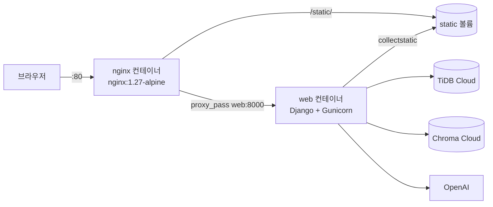

# 배포 가이드

Langration을 AWS EC2에 Docker Compose로 배포하는 방법입니다.

- 작성자: 심성욱
- 기준: 2026-11-05 `dev`
- 배포 주소: http://16.176.158.134/

## 1. 구성



| 파일 | 내용 |
|---|---|
| `Dockerfile` | python 3.12-slim, uv로 패키지 설치, 시작할 때 `migrate` → `collectstatic` → `gunicorn` (worker 1 · thread 4 · timeout 180) |
| `docker-compose.yml` | `web`(Django + Gunicorn, 내부 8000) · `nginx`(외부 80), 두 컨테이너가 `static` 볼륨을 함께 씀 |
| `deploy/nginx.conf` | `/static/`은 볼륨에서 바로 전달, 나머지는 `web:8000`으로, 스트리밍 버퍼링 끔 |
| `deploy/deploy.sh` | 서버에서 `git pull origin dev` → `docker compose up -d --build` → 상태 · 로그 확인 |

## 2. 처음 한 번 (EC2 준비)

1. EC2 인스턴스를 만들고 보안 그룹에서 **80번 포트**를 엽니다 (SSH 22번은 필요한 주소만).
2. Docker와 Docker Compose 플러그인을 설치합니다.
3. 저장소를 받습니다.

```bash
git clone https://github.com/SKNETWORKS-FAMILY-AICAMP/SKN35-4th-4Team.git
cd SKN35-4th-4Team
```

4. 저장소 폴더에 `.env`를 만듭니다 (Git에 올리지 않음).

| 키 | 값 |
|---|---|
| `OPENAI_API_KEY` | OpenAI 키 |
| `CHROMA_API_KEY` · `CHROMA_TENANT` · `CHROMA_DATABASE` | Chroma Cloud |
| `TIDB_HOST` · `TIDB_PORT` · `TIDB_USER` · `TIDB_PASSWORD` · `TIDB_DATABASE` | TiDB Cloud |
| `DJANGO_SECRET_KEY` | 새로 만든 긴 값 (비어 있으면 저장소의 공개 키를 쓰고 경고가 뜸) |
| `DJANGO_DEBUG` | `False` (Dockerfile 기본값도 False) |
| `DJANGO_ALLOWED_HOSTS` | EC2 주소 (예: `16.176.158.134`) |
| `DJANGO_CSRF_TRUSTED_ORIGINS` | `http://EC2주소` |
| `TIDB_CA_PATH` | 선택. 없으면 저장소의 인증서 → `certifi` 순서로 찾음 |

## 3. 배포 · 재배포

```bash
bash deploy/deploy.sh
```

| 단계 | 하는 일 |
|---|---|
| 1 | `git pull origin dev`로 최신 코드 받기 |
| 2 | `docker compose up -d --build`로 web · nginx 빌드하고 실행 |
| 3 | `docker compose ps`로 상태 확인 |
| 4 | `docker compose logs --tail 30 web`로 시작 로그 확인 (`migrate` → `collectstatic` → `gunicorn`) |

자주 쓰는 명령

```bash
docker compose logs -f web      # web 로그 계속 보기
docker compose restart web      # web만 다시 시작
docker compose down             # 멈추기 (-v 는 쓰지 않기: static 볼륨까지 지워짐)
```

## 4. 설정을 이렇게 한 이유

| 설정 | 이유 |
|---|---|
| Nginx까지 Docker Compose로 묶음 | 명령 하나로 받기 · 빌드 · 실행 |
| 외부에는 80번만, Django는 내부 8000번 | Gunicorn을 바로 노출하지 않고 Nginx 뒤에 둠 |
| 정적 파일은 공유 볼륨 → Nginx | Django가 CSS · JS까지 처리하지 않게 |
| `proxy_buffering off` · `proxy_cache off` + 응답 헤더 `X-Accel-Buffering: no` | Nginx가 응답을 모았다 한 번에 보내면 진행 단계가 실시간으로 안 보임 |
| `proxy_read_timeout 180s` = Gunicorn `--timeout 180` | 긴 답변(검사 · 재시도)도 끊기지 않게 |
| Gunicorn worker 1개 · thread 4개 | 그래프의 대화 기억(MemorySaver)이 서버 메모리에 있어 한 프로세스에 유지 |
| `DJANGO_DEBUG=False` 기본값 | DEBUG가 켜지면 오류 화면에 코드 · 설정이 그대로 보임 |

## 5. 자주 나는 문제

| 증상 | 원인 | 해결 |
|---|---|---|
| 재배포했는데 화면이 그대로 | 브라우저가 예전 CSS · JS를 계속 씀 (서버는 새 파일) | **Ctrl+F5** 또는 시크릿 창으로 열기. 서버 쪽은 `/static/js/chat.js`를 직접 열어 새 코드인지 확인 |
| 진행 단계가 끝에 한꺼번에 나옴 | Nginx 버퍼링 | `deploy/nginx.conf`의 `proxy_buffering off` 확인 |
| CSS · JS가 404 | collectstatic 실패 또는 볼륨 연결 문제 | `docker compose logs web`에서 collectstatic 줄 확인, `docker compose up -d --build` 다시 |
| 로그인 · 질문 POST가 403 | CSRF 허용 주소 누락 | `.env`의 `DJANGO_CSRF_TRUSTED_ORIGINS`에 `http://EC2주소` |
| 400 Bad Request (전체 페이지) | 허용 호스트 누락 | `.env`의 `DJANGO_ALLOWED_HOSTS`에 EC2 주소 |
| 첫 질문이 10초쯤 늦음 | 첫 요청 때 그래프를 만듦 | 정상. 시연 전에 질문 하나를 보내 두기 |
| 서버를 다시 켜면 앞 대화를 기억 못 함 | 대화 기억이 서버 메모리에 있음 | 정상 (TiDB의 질문 · 답 기록은 남음). 다음 단계: DB 체크포인터 |

## 6. 다음 단계

- 도메인 연결 + HTTPS 인증서 (지금은 HTTP라 비밀번호가 암호화 없이 전송됨)
- 대화 기억을 DB · Redis 체크포인터로 옮긴 뒤 worker 늘리기
- 정적 파일에 버전 쿼리 · 캐시 헤더를 붙여 재배포 후 캐시 문제 줄이기
