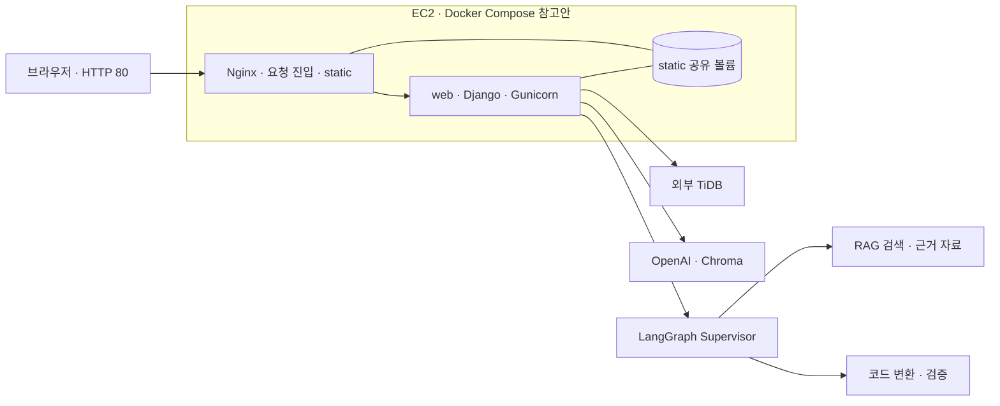

# 2026-11-04 1차 프로젝트 계획서 · LangChain 마이그레이션 어시스턴트

구버전 LangChain 코드를 입력하면 목표 버전에 맞춰 코드를 바꾸고, 문서 근거와 검증 결과를 보여주는 웹 애플리케이션입니다.

3차에서 구현한 LangGraph 기반 코드 마이그레이션·RAG 기능을 이어받아, 4차에서는 Streamlit 화면을 Django와 HTML 템플릿으로 전환하고 사용자·대화 관리와 클라우드 배포를 정리합니다.

> **진행 상태:** 개발 중. 아래 완료 여부는 2026-11-04 기준 `dev` 브랜치에 올라온 코드를 확인해 작성했습니다. 팀원 로컬의 미커밋 작업은 포함되지 않습니다.

## 팀 역할

| 번호 | 담당 | 역할 |
|---|---|---|
| ① | 최우석 | Django 백엔드·프로젝트 구조·발표 |
| ② | 조현주 | 클라우드 인프라·배포 |
| ③ | 손채영 | 검증 평가 재실행 |
| ④ | 심성욱 | 프론트엔드·팀 README·발표자료 |

## 프로젝트 목표

- Django 프로젝트에서 기존 LangGraph 마이그레이션 기능을 실행합니다.
- HTML·CSS·JavaScript와 Django 템플릿으로 메인 화면과 로그인 화면을 구성합니다.
- 사용자 정보와 대화 기록의 저장 구조를 정리합니다.
- Docker Compose로 로컬 실행을 확인하고, AWS EC2에 배포합니다.
- 3차 시연과 평가에서 확인한 개선점을 반영하고 다시 검증합니다.

## 주요 기능

3차에서 이어받은 핵심 기능은 다음과 같습니다. 4차 웹 화면과 Django 연결은 현재 진행 중입니다.

- **코드 마이그레이션:** 구버전 코드를 목표 LangChain 버전의 코드로 변환
- **문서 기반 검색:** 공식 문서와 import·메서드 대응 자료에서 변경 근거 검색
- **변경 내역 제공:** 변경한 코드와 이유, 근거, 설치가 필요한 패키지 표시
- **결과 검증:** 변환 코드와 근거를 검사하고, 문제가 있으면 재검색·재작성
- **질문 응답:** 마이그레이션 관련 문서 검색 질문과 일반 대화 처리
- **사용자·대화 관리:** 로그인과 사용자별 대화 기록 기능을 4차에서 연결할 예정

## 역할별 진행 체크리스트 · 11월 4일 기준

3차 README의 예전 평가 개선 목록은 3차 결과 기록입니다. 아래 표는 4차 저장소와 팀이 공유한 4차 진행 내용만 따로 정리합니다.

### 이모지 범례

| 표시 | 뜻 | 판정 기준 |
|---|---|---|
| ✅ 완료 | 코드에서 확인했거나 담당자가 완료했다고 공유한 항목 |
| 🔄 진행 중 | 작업 중이거나 확인이 진행 중인 항목 |
| 🔜 연기 | 오늘 범위에서 미뤄 다음 일정으로 넘긴 항목 |
| ⬜ 예정 | 아직 시작 전이며 계획된 항목 |

### 담당자별 진행 체크리스트

| 번호 · 담당 | ✅ 완료 | 🔄 진행 중 | 🔜 연기 | ⬜ 예정 |
|---|---|---|---|---|
| ① · 최우석 | Django 기본 구조와 `users`·`langration` 앱 생성, 3차 코드의 `langration/src/` 이관 확인<br>`/login/` 테스트 템플릿 렌더링은 팀 공유 및 저장소에서 확인 | `langration` URL·뷰와 Supervisor 실행 API 연결<br>`users`·`langration` 모델 및 DB 관리 방식 정리 | 확인된 연기 항목 없음 | 프론트와 API 계약 확정 후 정상·오류 응답 및 파이프라인 통합 확인<br>완료 기준: URL 응답, 그래프 실행, 결과 JSON 확인 |
| ② · 조현주 | EC2 생성, Django·Gunicorn 구동 및 배포 기본 설정 공유 | Nginx는 EC2 호스트, Django는 Docker Compose로 구동하는 구성 준비<br>원격 `dev`에 Docker 배포 파일 4개 추가 확인(11/4 09:49 KST) | 확인된 연기 항목 없음 | Docker Compose 로컬 구동과 EC2·Nginx 연결 확인<br>완료 기준: 컨테이너 로그, 접속 주소, DB 데이터 보존, 요청 전달 확인 |
| ③ · 손채영 | 검증 평가 재실행 담당 지정 | 확인된 진행 결과 없음 | 확인된 연기 항목 없음 | 3차 항목을 참고해 4차 평가 재실행<br>완료 기준: 질문·환경·결과·실패 사례 기록, 3차와 4차 결과 구분 |
| ④ · 심성욱 | `sungwook` 브랜치·로컬 작업 폴더 준비, README 초안 작성 | Django 템플릿 화면 이관 및 팀 README 보완 | 확인된 연기 항목 없음 | 메인 화면·API 연결·결과 패널 시연 준비, 발표자료 제작<br>완료 기준: 확인된 화면·수치로 문제-해결-시연-평가 흐름 구성<br>요구사항·화면설계·시스템 구성·테스트 문서는 전원과 협업해 정리 |

위 표의 완료 여부는 저장소 코드 또는 팀 공유 근거를 기준으로 판단합니다. 구현·실행 결과가 확인되지 않은 일은 예정 또는 진행 중으로 유지합니다.

## 오늘 진행 계획 · 오전 / 오후

### 오전 · URL과 API 계약

| 번호 | 체크리스트 |
|---|---|
| ① | 🔄 `langration` URL·뷰 연결 및 Supervisor 실행 API 구현·시험 |
| ② | ✅ EC2 생성, Django·Gunicorn 구동과 배포 설정 공유 완료. 🔄 Nginx는 EC2 호스트, Django는 Docker Compose로 실행하는 구성 정리 |
| ③ | ⬜ 평가 질문·환경·기준과 재실행 순서 정리 |
| ④ | 🔄 메인 템플릿 경로와 API 입력을 ①과 합의. ⬜ 응답 필드(변환 코드·변경 내역·근거·검증 결과·오류 정보) 정리 |

### 오후 · 템플릿·DB·로컬 확인

| 번호 | 체크리스트 |
|---|---|
| ① | ⬜ 사용자·대화 모델과 마이그레이션을 정리하고 SQLite 저장·조회를 확인. 기존 SQLAlchemy 테이블의 관리·이전 방식을 명확히 결정 |
| ② | 🔄 원격 `dev`의 Docker 배포 파일을 작업 브랜치에 반영. ⬜ Docker Compose 로컬 실행 및 EC2·Nginx 연결 확인. 파일 추가와 구동 성공을 구분해 기록 |
| ③ | ⬜ 평가 질문·재실행 범위를 정리하고 결과가 나오면 수치·한계 기록. 시간이 부족한 항목은 🔜 사유와 함께 다음 일정으로 이관 |
| ④ | ⬜ `templates/langration/home.html`에 화면 뼈대·결과 영역 구성, API 준비 시 실제 응답 연결. ⬜ README에 확인된 실행·배포 정보를 반영하고 발표 화면·구성도 초안 작성 |

**오늘의 완료 기준:** 메인 화면 URL이 열리고, 질문 입력과 결과 표시 영역이 준비되어 있으며, 백엔드 API 연결 상태·DB 상태·Docker 상태가 각각 확인 또는 미확인으로 기록되어 있는 것입니다. API나 Compose가 준비되지 않은 부분은 완료로 표시하지 않습니다.

### 평가 재실행에서 확인할 후보 · ③ 주 담당

아래는 3차 기록을 바탕으로 4차에서 다시 확인할 후보입니다. 3차 README의 완료 표시를 4차 완료로 옮기지 않고, 4차 코드와 평가 결과를 기준으로 판정합니다.

| 표시 | 확인 항목 | 오늘 할 수 있는 정리 |
|---|---|---|
| ✅ 3차 수정 이력 | `result["text"]` 검사기 빈틈은 3차 기록상 10월 15일 수정됨 | 4차에서 검증 코드가 유지됐는지 회귀 확인 대상으로 등록 |
| 🔄 범위 결정 | 대화 기억은 3차에서 일반 답변 중심으로 구현됐고 서버 재시작 시 사라지며 검색·변환은 현재 질문만 사용 | 4차에서 필요한 대화 기억 범위를 팀이 정하고 평가 질문 선정 |
| ⬜ 재검증 후보 | 질문 분류, 환각·근거 누락, 목표 버전별 검사, `langchain_classic` 우회 | 통합 API가 준비된 뒤 기존 실패 사례와 새 질문으로 확인하고 결과 기록 |
| ⬜ 시간 여유 시 | 추천 질문, 검색 단계 지표(Hit@k 등) | 평가 질문과 정답 근거가 정리된 경우에만 측정 범위와 지표를 추가 |

## 시스템 구성

아래는 첨부된 시각화 자료를 바탕으로 정리한 배포 구성 참고안입니다. 그림에는 EC2의 Docker Compose 안에서 Nginx와 Django 웹을 함께 실행하고, static 볼륨을 공유하는 구성이 표현되어 있습니다. 팀 대화에서는 Nginx를 EC2 호스트에서 실행하고 Django를 Docker Compose로 구동하는 안도 공유되어 두 방식의 최종 합의가 필요합니다. Docker 배포 파일은 원격 `dev`에 추가됐지만 로컬 Compose 구동은 별도 확인이 필요합니다.



브라우저 요청은 Nginx를 거쳐 Django 웹으로 전달되고, Django가 Supervisor 파이프라인과 외부 TiDB·OpenAI·Chroma를 사용한 뒤 화면에 결과를 표시하는 흐름입니다. 로그인 화면은 `users`, 마이그레이션 대화 기능은 `langration` 앱이 담당하는 방향입니다. Compose 구성과 Nginx 실행 위치는 팀 최종 결정에 맞춰 갱신합니다.

## 데이터베이스와 마이그레이션

Django 데이터베이스 마이그레이션은 `models.py`에 정의한 모델 변경을 데이터베이스 스키마에 적용하는 기능입니다. 모델을 정의하고 `makemigrations`로 변경 파일을 만든 다음 `migrate`로 적용해야 합니다. Django가 임의로 기존 데이터를 정리하거나 기존 SQLAlchemy 테이블을 자동으로 Django 모델로 바꾸는 기능은 아닙니다.

현재 `config/settings.py`의 기본 DB는 SQLite이며, `users/models.py`와 `langration/models.py`는 아직 비어 있습니다. 기존 `langration/src/ui/db.py`에는 SQLAlchemy 방식의 사용자·대화 테이블 코드가 남아 있습니다. 따라서 4차에서 다음 사항을 확정해야 합니다.

1. 사용자·대화 테이블을 Django 모델과 `migrate`로 관리할지 결정
2. 기존 SQLAlchemy 테이블과 저장 기록을 유지하거나 이전할지 결정
3. 로컬 SQLite와 AWS 운영 DB의 종류 및 연결 설정 결정
4. Docker 컨테이너를 다시 만들어도 데이터가 남도록 영속 저장 방식 설정

## 폴더 구조

```text
├── config/                 # Django 설정, 최상위 URL, WSGI/ASGI
├── users/                  # 로그인·사용자 관리 앱
├── langration/             # LangGraph 마이그레이션 앱
│   └── src/
│       ├── graph/          # Supervisor, 코드 변환 그래프와 노드
│       ├── prompt/         # 분류·분석·검색·재작성 프롬프트
│       ├── rag/            # 문서 수집·청킹·임베딩·검색
│       └── ui/             # 기존 화면 호출·결과·대화 저장 코드
├── templates/
│   ├── users/              # 로그인 화면 템플릿
│   └── langration/         # 마이그레이션 메인 화면 템플릿
├── data/                   # RAG 원본 및 처리 데이터
├── app.py                  # 파이프라인 단독 실행 예제
├── manage.py               # Django 관리 명령 진입점
├── pyproject.toml          # Python 패키지와 의존성
└── uv.lock                 # 의존성 잠금 파일
```

## 로컬 실행

저장소 루트에서 실행합니다.

```bash
uv sync
uv run python manage.py runserver
```

개발 서버 주소는 `http://127.0.0.1:8000/`입니다. 현재 구현된 테스트 로그인 화면은 `/login/`에서 확인할 수 있습니다. Langration 메인 화면은 Django URL 연결이 완료된 뒤 접근 경로를 확정해야 합니다.

기존 그래프를 Django와 별개로 실행하려면 다음 명령을 사용합니다.

```bash
uv run python app.py
```

실제 LLM·벡터 검색·DB 연결에는 환경변수가 필요합니다. 비밀 키와 실제 접속 정보는 `.env` 등 로컬 환경에 두고 GitHub에 올리지 않습니다. 현재 저장소에는 `.env.example`이 없으므로 실행에 필요한 변수 목록과 예시 파일을 정리해야 합니다.

## Docker 로컬 실행

2026-11-04 09:49 KST 원격 `dev`에 Docker 배포 파일 4개를 추가한 커밋이 확인됐습니다. 현재 문서 작업 중인 `sungwook` 로컬 브랜치에는 아직 해당 커밋이 반영됐는지 확인되지 않았으므로, 팀 브랜치에 반영된 파일을 기준으로 아래 실행 정보를 검증해 보완합니다.

- Docker Desktop 및 Compose 준비 방법
- Compose 설정에서 실행하는 서비스와 포트
- 환경변수 파일 준비 방법
- 빌드·실행·로그 확인·종료 명령
- SQLite 또는 운영 DB 데이터 보존 방법

## AWS 배포

팀에서 논의한 구조는 EC2 호스트의 Nginx가 외부 요청을 받고, Docker Compose 안의 Gunicorn·Django로 전달하는 방식입니다. 실제 배포 문서는 ②의 설정을 확인한 뒤 확정합니다.

배포 절차에 다음 내용을 기록할 예정입니다.

- EC2 접속과 코드 반영 방법
- Docker Compose 빌드·재시작과 로그 확인 방법
- Nginx가 Django 컨테이너로 전달하는 포트
- 환경변수와 DB 영속 저장 설정
- 정적 파일 처리와 공개 접속 주소

## 평가와 개선

3차에서는 코드 변환 결과를 일반 LLM과 비교하고 팀 자체 평가도 수행했습니다. 이 결과는 3차 기준이며, 4차 기능의 평가 결과로 간주하지 않습니다.

4차에서는 다음 항목을 기존 평가 자료와 시연 피드백을 바탕으로 다시 확인합니다.

- 화면에서 제출한 질문이 Django를 거쳐 Supervisor 그래프까지 전달되는지
- 변환 코드·근거·변경 내역·검증 결과가 화면에 표시되는지
- 로그인과 사용자별 대화 저장이 의도한 DB에 기록되는지
- 로컬 Docker 실행과 EC2 배포에서 같은 주요 기능이 동작하는지
- 이전 시연에서 결과가 좋지 않았던 질문이 개선되었는지

평가 질문, 실행 환경, 결과 수치와 한계는 재실행 후 기록합니다.

요구사항 정의서, 화면설계서, 시스템 구성도, 테스트 계획 및 결과 보고서는 담당 업무와 진행 여건에 맞춰 함께 작성합니다.

